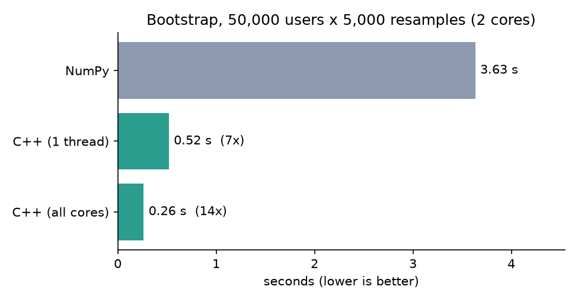
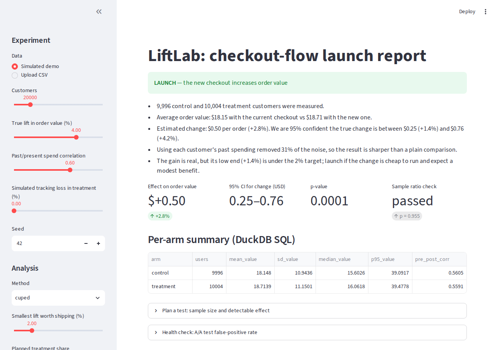

# LiftLab: Fast Experimentation Toolkit for Product Launch Measurement

A toolkit that designs, analyzes and monitors A/B tests for restaurant product launches, with a C++-accelerated resampling engine.

The running example is a new checkout flow tested on **order value**. LiftLab answers: how many customers do we need, did the change work, can we trust the data, and what should we tell the business?

## Features

- **Power & sample size** (`liftlab.power`): users per arm, minimum detectable effect and power for continuous metrics (with CUPED-adjusted variance) and for conversion rates.
- **Seeded simulator** (`liftlab.simulate`): right-skewed (log-normal) order values, a correlated pre-experiment covariate, a known true lift, and an optional "tracking loss" bug that produces sample-ratio mismatch.
- **Analysis** (`liftlab.analysis`): Welch t-test, CUPED, bootstrap CI and permutation test/CI. Tests check each against known simulated effects (CI coverage ≈ 95%, CUPED variance reduction ≈ ρ², unbiasedness).
- **C++17 / pybind11 engine** (`cpp/`): multithreaded bootstrap and permutation kernels, released-GIL, deterministic regardless of thread count; benchmarked against NumPy.
- **Guardrails** (`liftlab.guardrails`): chi-square SRM check and an A/A simulation that verifies the false-positive rate is consistent with alpha (Wilson interval).
- **DuckDB** (`liftlab.store`): experiment assignments stored and summarised with SQL.
- **Streamlit report** (`app/streamlit_app.py`): plain-English recommendation (launch / keep testing / do not launch / do not trust the data), plus planning and A/A health-check panels. Accepts simulated data or an uploaded CSV.

## Architecture

```
src/liftlab/
  simulate.py    seeded experiment generator
  power.py       sample size / MDE / power
  resampling.py  engine dispatch: C++ (_cpp) or NumPy reference
  analysis.py    t-test, CUPED, bootstrap, permutation -> AnalysisResult
  guardrails.py  SRM check, A/A simulation
  store.py       DuckDB persistence + SQL summaries
  report.py      results -> plain-English Recommendation
  benchmark.py   C++ vs NumPy timing
  cli.py         `liftlab` command
cpp/include/liftlab/resample.hpp   header-only kernels (xoshiro256**, std::thread)
cpp/src/bindings.cpp               pybind11 module liftlab._cpp
cpp/tests/test_resample.cpp        Catch2 tests
app/streamlit_app.py               stakeholder report
tests/                             pytest suite
tools/                             regenerate README chart and screenshot
docs/                              benchmark.png, report.png
```

## Setup

Requires Python ≥ 3.10 and a C++17 compiler (g++/clang). No services or secrets are needed.

```bash
python -m venv .venv && source .venv/bin/activate
pip install -e ".[dev]"      # builds the C++ extension too
cp .env.example .env         # optional; every setting has a default
```

## Run

```bash
liftlab demo --lift 0.04           # simulate one experiment, print the recommendation
liftlab power --lift 0.03 --corr 0.6   # sample size with CUPED
liftlab aa --method cuped --sims 500   # false-positive rate check
liftlab bench --users 50000 --resamples 5000
liftlab app                        # Streamlit report (http://localhost:8501)
```

Settings (`.env.example`): `LIFTLAB_ALPHA`, `LIFTLAB_SEED`, `LIFTLAB_THREADS`, `LIFTLAB_DB`. Export them in your shell (the app reads the process environment).

## Test

```bash
python -m pytest -q                                   # Python suite (48 tests, ~15 s)
# C++ tests need CMake >= 3.14 (pip install cmake) and network access (fetches Catch2)
cmake -S . -B build/cpp && cmake --build build/cpp && build/cpp/cpp_tests
```

CI (`.github/workflows/ci.yml`) runs both.

## Results

All numbers below are reproducible with `python tools/make_assets.py` (needs `pip install matplotlib`); they were measured on a 2-core machine with fixed seeds.

### Benchmark: Python vs. C++ bootstrap



50,000 users, 5,000 resamples (`liftlab bench`, best of 3):

| operation   | NumPy  | C++ 1 thread | C++ 2 threads | speedup (2 threads) |
|-------------|--------|--------------|---------------|---------------------|
| bootstrap   | 3.63 s | 0.52 s       | 0.26 s        | **14x**             |
| permutation | 3.37 s | 0.65 s       | 0.32 s        | **10x**             |

The baseline is vectorised, chunked NumPy, not a Python loop. About half of the speedup comes from the single-threaded C++ kernel (7x) and the rest from threads, so it should scale further on machines with more cores. Absolute numbers vary by machine.

### CUPED variance reduction

On a simulated experiment (100,000 users, true lift 4%, pre/post spend correlation 0.56):

| method | 95% CI width ($) | variance removed |
|--------|------------------|------------------|
| Welch t-test | 0.273 | n/a |
| CUPED | 0.226 (**17% narrower**) | 31.5% (matches rho^2 = 0.56^2) |

The tests assert this relationship: variance reduction equals rho^2 and the CI width ratio equals sqrt(1 - rho^2).

### Guardrail: A/A simulation

1,000 simulated experiments with no real effect, alpha = 0.05: the t-test rejects **5.3%** (95% CI 4.1-6.9%) and CUPED **5.2%** (4.0-6.8%), so the false-positive rate stays at the nominal 5%.

### Stakeholder report



The page shows the plain-English recommendation first, then the effect, confidence interval, p-value and sample-ratio check. Regenerate the screenshot with `python tools/screenshot.py` (needs `pip install playwright && playwright install chromium`).

### Summary line

> Built an experimentation toolkit (CUPED, bootstrap, SRM checks) with a C++/pybind11 engine delivering a 14x bootstrap speedup over NumPy; validated by A/A simulations holding the false-positive rate at 5%.

## Key design decisions

- **Reproducible parallelism.** Each replicate `i` has its own RNG stream seeded from `(seed, i)`, so results are bit-identical for any thread count (tested in pytest and Catch2). The C++ and NumPy engines use different generators, so they agree statistically, not bit-for-bit.
- **Fair baseline.** The "pure Python" comparison is vectorised NumPy (chunked), not a Python loop, so the speedup is against a realistic implementation.
- **Optional extension.** If the C++ module is not built, everything falls back to NumPy (`engine="auto"`); `engine="cpp"` raises a clear error.
- **CUPED.** θ is estimated on pooled data (independent of assignment), keeping the estimate unbiased. Bootstrap/permutation can be run on raw outcomes only; CUPED uses the analytic Welch interval on adjusted values.
- **Permutation CI** uses the shift-model: observed effect minus the null-distribution quantiles. The bootstrap interval is the percentile interval.
- **SRM threshold p < 0.001**, the industry convention: SRM signals broken data, so the check is deliberately conservative to avoid false alarms. A failed SRM overrides any other verdict.
- **Recommendation rules** use a business-defined minimum worthwhile lift (default 2%): clear win → launch; significant but small → launch if cheap; significant loss → do not launch; CI entirely below the target → no meaningful benefit; otherwise keep testing, with an estimate of the sample needed.
- **Simulated data.** Order values are log-normal linked via a Gaussian copula; the realised pre/post correlation is therefore lower than the latent `pre_post_corr`, and tests use the measured correlation.
- **Storage.** DuckDB in-memory by default (zero setup); set `LIFTLAB_DB` to a file to persist.

## Limitations

Single metric per test, fixed-horizon analysis (no sequential testing/peeking correction), and no multiple-comparison adjustment.
